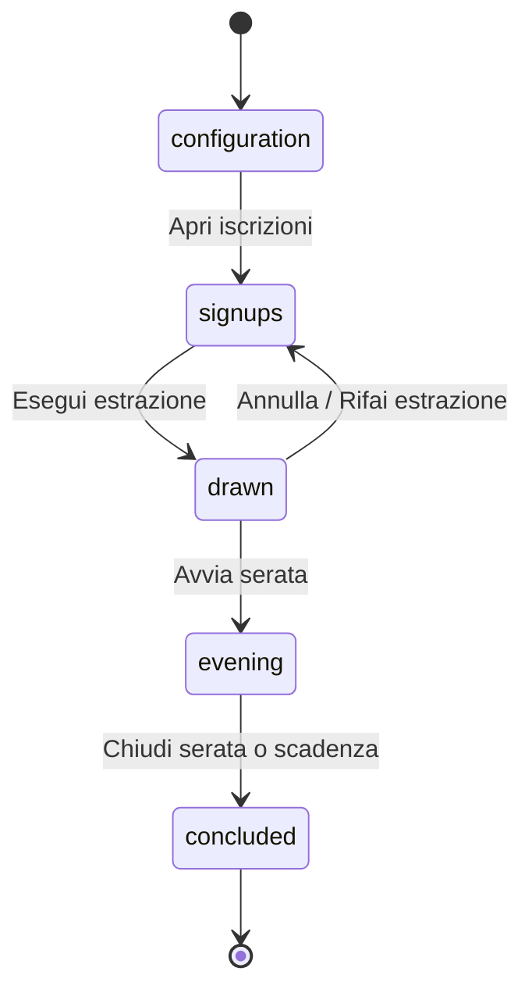

# Architettura – Secret Santa

Riferimento: [docs/spec/functional-spec.md](spec/functional-spec.md). Questo documento riassume le sezioni 4, 7 e 9; in caso di conflitto prevale la specifica.

## Stack (spec §9.1)

- App: Expo (React Native), TypeScript strict, Expo Router, TanStack Query.
- Auth: Supabase Auth con Google (ID token nativo); richiede development build EAS, non Expo Go.
- Database: Postgres su Supabase con RLS su ogni tabella.
- Logica sensibile: funzioni Postgres (security definer) ed Edge Functions; solver in `supabase/functions/_shared/solver`.
- Dati: refetch, pull to refresh, polling 30 s (DSH-3). Niente Realtime nell'MVP.
- Job pianificato (pg_cron): chiusura automatica serate, eliminazione dettagli dopo 30 giorni; scadenza verificata anche in lettura.
- Build: EAS Build / EAS Submit.

## Stati dell'edizione (spec §4)

- Stati: `configuration`, `signups`, `drawn`, `evening`, `concluded`, più il flag `incomplete`.
- Unica transizione all'indietro: annulla estrazione. «Rifai» = annulla + estrai in un solo passaggio.
- `incomplete`: un partecipante esce, è rimosso o cancella l'account dopo l'estrazione. Avviso a tutti; niente nuove domande né avvio serata finché l'admin non rifà l'estrazione.
- Permessi per stato e ruolo: tabella in §4, imposti dal server (funzioni e RLS); l'app nasconde solo i pulsanti.

## Modello dati (spec §9.2, visibilità §7)

| Tabella                           | Chi legge dal client                                         |
| --------------------------------- | ------------------------------------------------------------ |
| profiles                          | Membri dei propri gruppi                                     |
| groups                            | Membri approvati                                             |
| group_members                     | Membri; scrittura via funzioni                               |
| group_invites                     | Solo admin                                                   |
| editions                          | Partecipanti; scrittura via funzioni                         |
| edition_signups                   | Membri; ognuno modifica il proprio stato                     |
| exclusion_rules                   | Solo admin                                                   |
| assignments                       | Nessuno: solo funzioni server                                |
| draw_log                          | Solo admin                                                   |
| question_catalog, mission_catalog | Sola lettura                                                 |
| edition_disabled_questions        | Partecipanti                                                 |
| edition_missions                  | Solo admin                                                   |
| mission_assignments               | Ognuno la propria riga (tutte dopo la chiusura)              |
| edition_questions                 | Donatore le proprie; destinatario le ricevute senza mittente |
| gift_received                     | Ognuno la propria                                            |
| guesses                           | Autore fino alla chiusura                                    |
| award_votes                       | Autore fino alla chiusura                                    |
| edition_results                   | Partecipanti, solo dopo la chiusura                          |

Dopo la chiusura (§7): abbinamenti e missioni visibili ai partecipanti; ipotesi altrui solo aggregate; voti solo come risultati; domande e risposte eliminate dopo 30 giorni.

## Funzioni server (spec §9.3)

| Funzione                           | Chiamante                    |
| ---------------------------------- | ---------------------------- |
| join_group                         | Utente                       |
| review_member                      | Admin                        |
| execute_draw                       | Admin                        |
| cancel_draw                        | Admin                        |
| get_my_recipient                   | Partecipante (una sola riga) |
| ask_question, answer_question      | Donatore, destinatario       |
| start_evening                      | Admin                        |
| mark_received, set_guess, set_vote | Partecipante                 |
| close_evening                      | Admin o job                  |
| transfer_admin                     | Admin                        |
| delete_account                     | Utente                       |

Ogni funzione: `security definer`, `search_path` impostato, controllo di ruolo, stato e scadenza; operazioni critiche transazionali e ripetibili (NFR-2).

## Algoritmo di estrazione (spec §9.4)

1. Matrice dei destinatari ammessi: esclusioni e anti-ripetizione tolte.
2. Verifica di fattibilità con Hopcroft-Karp; «vieta scambi diretti» controllato durante la ricerca.
3. Estrazione con `crypto.getRandomValues`, backtracking con controllo di fattibilità a ogni passo.
4. Ricontrollo di tutti i vincoli sul risultato.
5. Salvataggio di abbinamenti e missioni in una transazione, con lock sull'edizione.
6. Se impossibile: diagnosi con sottoinsieme minimo di regole in conflitto, più controlli su minimo partecipanti e anti-ripetizione. Mai correzioni manuali a posteriori.

## Sicurezza e privacy (spec §9.5, NFR-3, NFR-4)

- RLS su tutte le tabelle; nessuna policy permette di leggere `assignments`.
- Il proprio destinatario solo via `get_my_recipient`.
- Nessun segreto nel client; variabili pubbliche con prefisso `EXPO_PUBLIC_`.
- Abbinamenti non cifrati: lo sviluppatore ha accesso tecnico, da dichiarare nell'informativa.
- Cancellazione account: profilo «Ex partecipante», abbinamenti conclusi senza dati personali, ipotesi, voti e risposte eliminati; l'admin deve prima trasferire il ruolo.
- Invito via deep link o codice di 8 caratteri.
- Diagnostica errori senza abbinamenti né contenuti di gioco (NFR-9).
